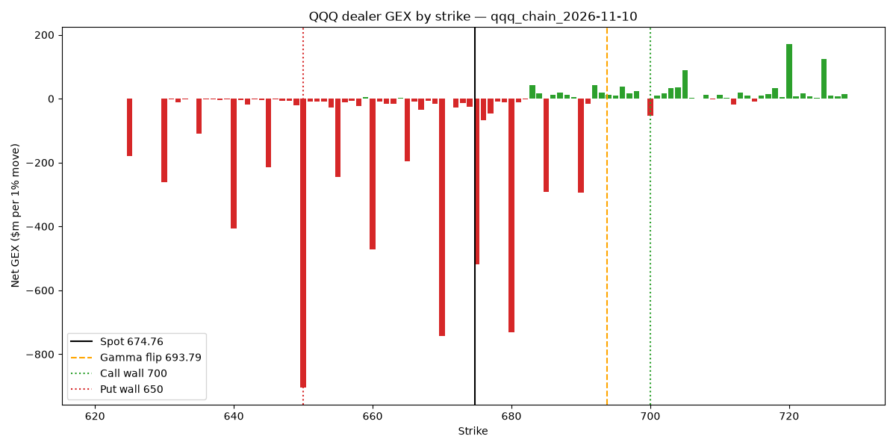

# Do GEX Levels Work?

I trade Nasdaq futures, and a lot of options-flow traders (me included) mark "gamma levels" on their charts. The idea is that market makers hedge their options positions in a way that pushes price around, so certain levels should act as support, resistance, or a switch between calm and volatile markets.

These levels usually come from paid dashboards and get treated as fact. I wanted to build them myself from raw options data and then test whether price actually respects them.

**Status:** in progress. Data collection and the GEX calculation work. The tests are next.



*Each bar is the dealer gamma at one strike. Red means dealers amplify moves there, green means they dampen them. The orange line is the gamma flip.*

## What it calculates

Every evening, `collect.py` downloads the full QQQ option chain (around 9,000 contracts) and `gex.py` works out:

- **Total GEX:** whether dealers are overall dampening moves (positive) or amplifying them (negative)
- **Gamma flip:** the price where that switches
- **Call wall:** the biggest call gamma strike above price, which traders treat as resistance
- **Put wall:** the biggest put gamma strike below price, which traders treat as support

On 10 November 2026, QQQ closed at 674.76, with total GEX of −$4.97bn, the gamma flip at 693.79, the call wall at 700 and the put wall at 650. Price was well below the flip, so in theory dealers were amplifying moves that day.

## How it works

For each option, I calculate gamma using Black-Scholes, then multiply by open interest to get the dollars of QQQ dealers would need to trade for a 1% move. Adding these up by strike gives the GEX profile in the chart.

The biggest assumption is the sign: I assume dealers are long calls and short puts, which is the standard assumption in GEX models. Nobody outside the dealers actually knows their positions, so every GEX number anyone shows you rests on a guess like this.

I also dropped expired options, options with no open interest, and implausible implied volatilities, since free data has a lot of noise. My first version accidentally kept options that had expired that afternoon, which created a fake "wall" right at the current price. Fixing that time zone bug changed the levels noticeably.

## What I'm going to test

1. **Regime:** do days that open below the gamma flip really have bigger ranges and more trending than days above it?
2. **Walls:** does price bounce off the call and put walls more often than off random levels the same distance away? Price bounces off plenty of levels by chance, so the random comparison is what shows whether the walls mean anything.

I'm writing down what counts as a pass before looking at the results, so I can't explain the outcome after the fact.

## Limitations

- Dealer positions aren't public, so the long calls / short puts assumption could be wrong.
- Open interest only updates once a day, so intraday and 0DTE positioning is missed.
- Free Yahoo Finance data is noisy.
- QQQ is only part of the Nasdaq options market. NDX and NQ futures options also matter.
- I only started collecting data, so the sample is small for now.

## Running it

```
python3 -m venv .venv
.venv/bin/python -m pip install -r requirements.txt
.venv/bin/python src/collect.py
.venv/bin/python src/gex.py
```

Run `collect.py` after the US market closes. The data is saved to `data/`, which isn't uploaded here.
